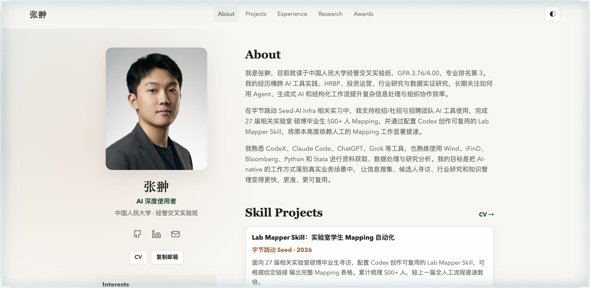

# 张翀 | 个人主页

**在线访问 → [zc-ruc.github.io/-/](https://zc-ruc.github.io/-/)**

静态个人主页：About / Projects / Experience / Research / Awards，深浅色一键切换（◐）。

## 页面结构

| 文件 | 内容 |
|---|---|
| `index.html` | 主页（关于我、兴趣方向、项目与经历入口） |
| `cv.html` | 完整简历 |
| `mcm-paper.html` | 数学建模论文 |
| `qiushi-paper.html` | 求是杯论文 |
| `styles.css` / `script.js` | 样式与交互（深色模式） |
| `assets/` | 图片等静态资源 |

## 本地预览与部署

纯静态、零构建：直接打开 `index.html`。线上版由 GitHub Pages 托管（main 分支根目录）。

## 关于我

中国人民大学经管交叉实验班（2023 级），关注 AI Agent × 招聘流程提效、硬科技与先进制造、产业研究与数据实证。详见站内 About 页。
